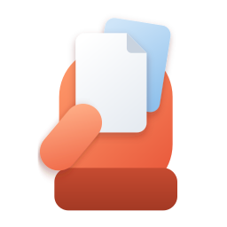

# Spare Hand

Windows 11 used to have a little tray that slid down from the top of the screen when you dragged a file. You dropped the file on WhatsApp or Outlook and it got shared. Microsoft started removing it in August 2026, mostly because it kept popping up when people were just moving files around.

I actually used it. Mostly to throw files at Quick Share and LocalSend.

So I built my own, and this one only shows up when you ask for it.

**Drag a file, double-tap Alt, and a small tray opens next to your cursor.** Drop the file where it needs to go.

> Early days: it works well on the machine it was built on, and needs more people trying it. Issues and feedback are very welcome.

## What's in the tray

- **Hold** keeps the file aside so you can drag it back out later, from anywhere. It only remembers *where* the file is: nothing gets copied, moved or deleted, and nothing expires.
- **Send**
  - **Quick Share** opens with the file ready, the same as right-click → *Send with Quick Share*.
  - **LocalSend** opens a small picker with the devices on your network. Pick one and it sends. Spare Hand talks to LocalSend directly, so the LocalSend app isn't needed on this PC.
- **Move to**
  - **Desktop**.
  - **More…** asks where after you drop. It starts in the File Explorer window you used last, skipping the folder the file is already in.

  Moves and copies follow Explorer's own rules (same drive moves, another drive copies, Shift or Ctrl to choose), with Explorer's progress, conflict and undo dialogs.

## Getting things back out

Double-tap Alt with nothing held and the **Hold library** opens at your cursor: everything you've held, with real thumbnails. Drag one item or a whole selection into any app. Right-click for Open with, Show in folder, Copy path, or sending it somewhere. Clearing can be undone, and if a file moved since you held it, Spare Hand says so instead of quietly dropping it.

Click anywhere outside, press Esc, or double-tap again to close it.

## Settings

Right-click the hand in the notification area. You can change the trigger key (Alt, Ctrl or Shift), pick which Send tiles show up, add a normal shortcut for the library, keep Spare Hand quiet in fullscreen apps, games and any app you choose, and start it with Windows.

If you pick Ctrl and have PowerToys Find My Mouse on its default double-Ctrl, the settings page warns you, because both would fire.

## Install

**[Download SpareHand-Setup.exe](https://github.com/Sammy949/spare-hand/releases/latest/download/SpareHand-Setup.exe)** (about 24 MB) and run it. It installs just for you, so no admin prompt, and you can have it start when you sign in.

Windows will probably say **"Windows protected your PC"** first. That's SmartScreen being cautious about a new app that isn't code-signed yet (signing costs money I haven't spent yet). Click **More info**, then **Run anyway**. If you'd rather not trust an installer from a stranger, the whole thing builds from this repo in a minute, see below.

To remove it: Settings → Apps → Spare Hand → Uninstall. It asks whether to keep your settings and Hold list.

x64 Windows 11. It targets Windows 10 (19041) and later too, but hasn't been tried there yet.

### Build it yourself

```powershell
git clone https://github.com/Sammy949/spare-hand
cd spare-hand
dotnet build src/SpareHand/SpareHand.csproj -c Release -p:Platform=x64
```

You need the [.NET 10 SDK](https://dotnet.microsoft.com/download). No Visual Studio required.

## Privacy

- No account, no telemetry, no analytics.
- The only network traffic is LocalSend on your local network, and only for discovery and files you choose to send.
- Settings, the Hold list and logs live in `%LOCALAPPDATA%\SpareHand`. The Hold list stores file paths, never copies of your files.

## Why it looks like PowerToys

It's built to sit next to PowerToys and maybe end up in it one day. The tray, the library and the settings page use PowerToys' own design language: the same acrylic surface, card shape and settings controls, and the same tricks for small pop-up windows. Idle memory stays in the single digits of MB, the same way PowerToys keeps it low. More in [docs/design.md](docs/design.md).

## Before building it

I went through the complaints about Microsoft's tray, the PowerToys requests for a file shelf, and every App Store review I could get for the Mac apps that do this (Yoink, Dropover and friends, about 3,000 reviews). Two things stood out. The most common wish was getting files to your *other* devices, which is why sharing sits at the centre here. And the 1★ reviews were mostly about nags, paywalls and crashes, not missing features. So Spare Hand is free, never nags, and treats reliability as a feature. The details are in [docs/research.md](docs/research.md).

## Docs

- [docs/research.md](docs/research.md): what people liked and hated, and what that changed
- [docs/design.md](docs/design.md): the PowerToys design language and window model
- [docs/architecture.md](docs/architecture.md): how it works, and the bugs that shaped it
- [docs/roadmap.md](docs/roadmap.md): what's done and what's next
- [CONTRIBUTING.md](CONTRIBUTING.md): building, testing, and the house rules

## Credits

Spare Hand stands on [PowerToys](https://github.com/microsoft/PowerToys) (MIT), whose always-active acrylic backdrop is included as is, plus [WinUIEx](https://github.com/dotMorten/WinUIEx), the [Windows Community Toolkit](https://github.com/CommunityToolkit/Windows) and the [Windows App SDK](https://github.com/microsoft/WindowsAppSDK), all MIT. LocalSend support is written from the [LocalSend protocol](https://github.com/localsend/protocol) spec. See [THIRD-PARTY-NOTICES.md](THIRD-PARTY-NOTICES.md).

Not affiliated with Microsoft, Google or LocalSend.

## License

[MIT](LICENSE)
